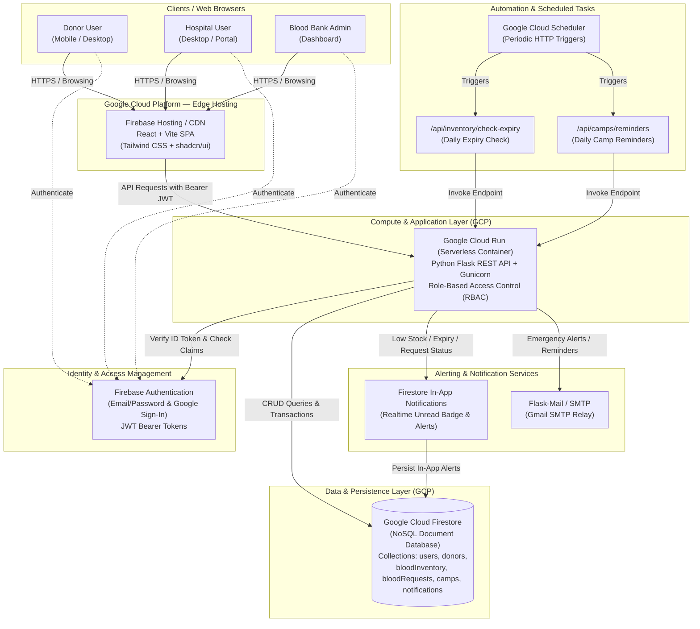

# 🏗️ Cloud Blood Bank System Architecture

## High-Level System Architecture Diagram

---

## Component Breakdown

### 1. Presentation Tier (Frontend SPA)
- **Framework:** React 18, Vite build tool, Tailwind CSS, shadcn/ui component primitives, Lucide React icons.
- **Routing & State:** React Router 6, React Context (`AuthContext`), custom API hooks (`useApi`).
- **Hosting:** Firebase Hosting with global SSD CDN distribution, SSL/TLS termination, and single-page routing rewrites.

### 2. Identity Tier (Firebase Authentication)
- Manages authentication via Email/Password and OAuth (Google Sign-In).
- Issues signed JSON Web Tokens (JWT) verified on every backend API invocation via Firebase Admin SDK.
- Decouples credentials from the backend database while preserving granular Role-Based Access Control (`admin`, `hospital`, `donor`).

### 3. Application Tier (Backend REST API on Google Cloud Run)
- **Engine:** Python 3.11 with Flask, Marshmallow schema validation, and Gunicorn WSGI container.
- **Containerization:** Production Docker container deployed to Google Cloud Run with automatic horizontal scaling (0 to N instances).
- **Security:** Token verification decorator (`@require_auth`), role enforcement decorator (`@require_role`), CORS origin filtering.

### 4. Database Tier (Google Cloud Firestore)
- Fully managed, highly available NoSQL document database.
- Key Collections:
  - `users`: User metadata and roles (`admin`, `hospital`, `donor`).
  - `donors`: Donor personal details, blood group, eligibility calculation, donation history.
  - `bloodInventory`: Inventory units, blood type, collection/expiry dates, status.
  - `bloodRequests`: Hospital requests, patient info, urgency level, approval/fulfillment status.
  - `camps`: Blood donation drives, venues, capacities, registered donors.
  - `notifications`: User notifications for expiry, request updates, camp reminders, low stock.

### 5. Automated Background Jobs (Cloud Scheduler)
- **Daily Expiry Check:** Calls `/api/inventory/check-expiry` to auto-mark expired blood units and notify administrators of units expiring within 7 days.
- **Camp Reminders:** Calls `/api/camps/reminders` 24 hours before scheduled donation drives to notify registered donors.
