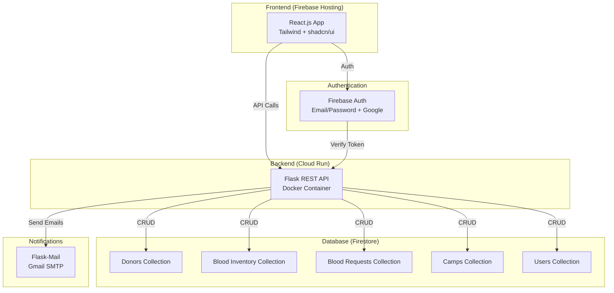

# 🩸 Cloud-Based Blood Bank Management System — Project Plan

## Technical Stack Summary

| Layer | Technology | Cost |
|-------|-----------|------|
| **Frontend** | React.js + Tailwind CSS + shadcn/ui | Free |
| **Backend** | Python Flask (REST API) | Free |
| **Database** | Google Cloud Firestore (NoSQL) | Free tier |
| **Authentication** | Firebase Authentication | Free |
| **Frontend Hosting** | Firebase Hosting | Free |
| **Backend Hosting** | Google Cloud Run | Free tier (2M req/month) |
| **Notifications** | Flask-Mail + Gmail SMTP | Free |
| **Containerization** | Docker | Free |
| **CI/CD** | Cloud Build | 120 min/day free |

> [!TIP]
> **Estimated total cost: $0** — Everything runs within GCP's always-free tier and Firebase free plan.

---

## System Architecture



---

## User Roles & Permissions

| Feature | Admin | Hospital/Recipient | Donor |
|---------|-------|--------------------|-------|
| Manage blood inventory | ✅ | ❌ | ❌ |
| Add/remove blood units | ✅ | ❌ | ❌ |
| Create donation camps | ✅ | ❌ | ❌ |
| View all donors | ✅ | ❌ | ❌ |
| Search donors by blood type | ✅ | ✅ | ❌ |
| Request blood | ✅ | ✅ | ❌ |
| Approve/reject requests | ✅ | ❌ | ❌ |
| Register as donor | ❌ | ❌ | ✅ |
| View own profile | ✅ | ✅ | ✅ |
| View upcoming camps | ✅ | ✅ | ✅ |
| Register for a camp | ❌ | ❌ | ✅ |
| View notifications | ✅ | ✅ | ✅ |

---

## Features (6 Modules)

### 1. 👤 Donor Registration & Profile Management
- Register with name, email, phone, blood type, DOB, address, medical history
- Track last donation date and eligibility (56-day gap)
- View and edit own profile
- Donation history log

### 2. 🩸 Blood Inventory Management
- Track blood units: blood type, quantity (ml), collection date, expiry date, status
- Auto-calculate expiry (35 days for whole blood, 42 days for RBCs)
- Color-coded stock levels (critical/low/adequate/surplus)
- Filter and search by blood type, status, expiry

### 3. 📋 Blood Request Management
- Hospitals submit requests: blood type, quantity, urgency level, patient info
- Admin reviews and approves/rejects
- Auto-match with available inventory
- Track request status: pending → approved → fulfilled / rejected

### 4. 🏕️ Blood Donation Camp Management
- Create camps: name, venue, date/time, organizer, capacity
- Donors can view upcoming camps and register
- Track registrations vs. capacity
- Post-camp: record donations collected

### 5. 🔍 Donor Search & Matching
- Search donors by blood type, location, availability
- Compatible blood type matching (e.g., O- is universal donor)
- Filter by last donation date (eligibility check)
- Emergency donor alerts

### 6. 📧 Expiry Alerts & Notifications
- Email alerts for blood units expiring within 7 days
- Request status update emails
- Camp reminder emails to registered donors
- Low stock alerts to admin

---

## Firestore Data Model

```
├── users/
│   └── {uid}
│       ├── email, displayName, role, createdAt
│       └── phone, organizationName (for hospitals)
│
├── donors/
│   └── {donorId}
│       ├── uid, name, email, phone, bloodType
│       ├── dateOfBirth, gender, address
│       ├── medicalHistory, lastDonationDate
│       └── isEligible, createdAt, updatedAt
│
├── bloodInventory/
│   └── {unitId}
│       ├── bloodType, quantity, unit (ml)
│       ├── collectionDate, expiryDate
│       ├── donorId, status (available/reserved/expired/used)
│       └── collectedAt (campId or walk-in), addedBy
│
├── bloodRequests/
│   └── {requestId}
│       ├── requestedBy (uid), hospitalName
│       ├── bloodType, quantity, urgencyLevel
│       ├── patientName, patientAge, reason
│       ├── status (pending/approved/fulfilled/rejected)
│       └── approvedBy, fulfilledAt, createdAt
│
├── camps/
│   └── {campId}
│       ├── name, venue, address, date, startTime, endTime
│       ├── organizer, capacity, description
│       ├── registeredDonors[] (array of donorIds)
│       ├── status (upcoming/ongoing/completed/cancelled)
│       └── unitsCollected, createdBy, createdAt
│
└── notifications/
    └── {notificationId}
        ├── recipientUid, type, title, message
        ├── isRead, createdAt
        └── relatedEntity (requestId/campId/unitId)
```

---

## Project Structure

```
CC_project/
├── backend/                    # Flask API
│   ├── app/
│   │   ├── __init__.py         # Flask app factory
│   │   ├── config.py           # Configuration
│   │   ├── auth.py             # Firebase Auth middleware
│   │   ├── models/             # Data models / schemas
│   │   ├── routes/
│   │   │   ├── donors.py
│   │   │   ├── inventory.py
│   │   │   ├── requests.py
│   │   │   ├── camps.py
│   │   │   ├── users.py
│   │   │   └── notifications.py
│   │   ├── services/
│   │   │   ├── donor_service.py
│   │   │   ├── inventory_service.py
│   │   │   ├── request_service.py
│   │   │   ├── camp_service.py
│   │   │   └── email_service.py
│   │   └── utils/
│   │       ├── blood_compatibility.py
│   │       └── validators.py
│   ├── requirements.txt
│   ├── Dockerfile
│   ├── .env.example
│   └── run.py
│
├── frontend/                   # React App
│   ├── public/
│   ├── src/
│   │   ├── components/
│   │   │   ├── ui/             # shadcn components
│   │   │   ├── layout/         # Navbar, Sidebar, Footer
│   │   │   └── common/         # Shared components
│   │   ├── pages/
│   │   │   ├── auth/           # Login, Register
│   │   │   ├── dashboard/      # Role-based dashboards
│   │   │   ├── donors/         # Donor management
│   │   │   ├── inventory/      # Blood inventory
│   │   │   ├── requests/       # Blood requests
│   │   │   └── camps/          # Camp management
│   │   ├── contexts/           # Auth context
│   │   ├── hooks/              # Custom hooks
│   │   ├── services/           # API service layer
│   │   ├── lib/                # Utils, Firebase config
│   │   └── App.jsx
│   ├── package.json
│   ├── tailwind.config.js
│   └── vite.config.js
│
├── docs/                       # Project report & diagrams
│   ├── architecture-diagram.png
│   └── project-report.md
│
├── .github/                    # CI/CD (optional)
├── README.md
└── .gitignore
```

---

## GCP Free Tier Services Used

| Service | Free Tier Limit | Our Usage |
|---------|----------------|-----------|
| **Cloud Run** | 2M requests/month, 360K GB-seconds | API hosting (minimal traffic) |
| **Firestore** | 50K reads, 20K writes/day | All database operations |
| **Firebase Auth** | Unlimited email/password users | User authentication |
| **Firebase Hosting** | 10 GB storage, 360 MB/day transfer | React app static files |
| **Cloud Build** | 120 build-minutes/day | Docker image builds |
| **Container Registry** | 500 MB storage (free) | Docker images |
| **Cloud Scheduler** | 3 free jobs | Expiry check cron job |

---

## Build Phases

### Phase 1: Project Setup & Authentication
- Initialize Flask backend with project structure
- Initialize React frontend with Vite + Tailwind + shadcn
- Set up Firebase project (Auth + Firestore)
- Implement login/register with role selection
- Auth middleware in Flask (verify Firebase tokens)

### Phase 2: Core Features — Donor & Inventory
- Donor registration and profile CRUD
- Blood inventory CRUD with expiry tracking
- Admin dashboard with stock overview

### Phase 3: Requests & Camps
- Blood request submission and management
- Camp creation and donor registration
- Blood type compatibility matching

### Phase 4: Notifications & Search
- Email notification service
- Donor search by blood type/location
- Expiry alert system (Cloud Scheduler cron)

### Phase 5: Deployment
- Dockerize Flask backend
- Deploy backend to Cloud Run
- Build and deploy frontend to Firebase Hosting
- Set up environment variables and secrets

### Phase 6: Documentation & Presentation
- System architecture diagrams
- Project report
- 10-minute demo video script
