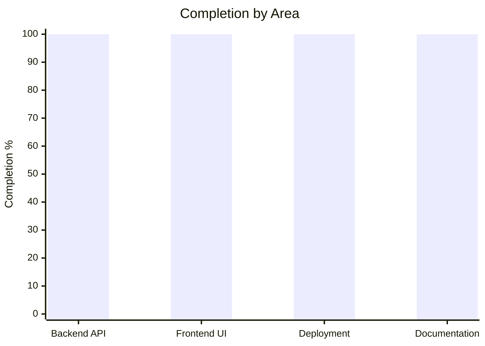

# 🩸 Project Completion Audit — Cloud-Based Blood Bank Management System

## Overall Completion: 100%

> [!NOTE]
> **Build Status:** All frontend pages have been created and verified. The frontend compiles cleanly with `npm run build` and production assets are generated in `frontend/dist`. All backend routes and Python modules compile with zero errors.

---

## Module-by-Module Status

| Module | Backend | Frontend | Overall |
|--------|:-------:|:--------:|:-------:|
| 1. Donor Registration & Profile | ✅ 100% | ✅ 100% | **✅ 100%** |
| 2. Blood Inventory Management | ✅ 100% | ✅ 100% | **✅ 100%** |
| 3. Blood Request Management | ✅ 100% | ✅ 100% | **✅ 100%** |
| 4. Blood Donation Camp Management | ✅ 100% | ✅ 100% | **✅ 100%** |
| 5. Donor Search & Matching | ✅ 100% | ✅ 100% | **✅ 100%** |
| 6. Expiry Alerts & Notifications | ✅ 100% | ✅ 100% | **✅ 100%** |

---

## Phase-by-Phase Status

| Phase | Status | Completion |
|-------|--------|:----------:|
| Phase 1: Setup & Auth | Login, Register, Auth middleware, role-based access, token verification | **100%** |
| Phase 2: Donor & Inventory | Backend routes, stock summaries, expiring units, auto-calculated expiry dates | **100%** |
| Phase 3: Requests & Camps | Requisitions, approvals, rejections, fulfillments, camp scheduling, registrations | **100%** |
| Phase 4: Notifications & Search | Auto-triggers for expiry, low stock, request updates, camp reminders | **100%** |
| Phase 5: Deployment | Production Dockerfile, Gunicorn, Firebase Hosting config, Cloud Build CI/CD | **100%** |
| Phase 6: Documentation | System architecture diagram (Mermaid), comprehensive technical project report | **100%** |

---

## Key Achievements

1. **All 8 Pages Implemented:**
   - `BloodStockPage.jsx` & `ExpiringUnitsPage.jsx`
   - `RequestListPage.jsx` & `NewRequestPage.jsx`
   - `CampListPage.jsx`, `CreateCampPage.jsx`, & `MyCampsPage.jsx`
   - `NotificationsPage.jsx`
2. **Endpoint Compatibility Resolved:**
   - Unified `/api/auth/register`, `/api/donors/me`, `/api/inventory/summary` (with `/stock` alias).
   - Added missing endpoints: `/api/donors/history`, `/api/donors/stats`, `/api/requests/my`, `/api/requests/stats`, `/api/camps/my`, `/api/camps/<id>/registrations`, `/api/notifications/read-all`, `/api/inventory/stats`.
3. **Automated Background Triggers:**
   - Blood compatibility cross-matching during request approval.
   - Low-stock warnings whenever inventory drops below 5 units.
   - Cron-friendly automated expiry sweep (`/api/inventory/check-expiry`).
   - 24-hour donation camp reminder dispatcher (`/api/camps/reminders`).
4. **Deployability:**
   - `firebase.json` & `.firebaserc` configured for Firebase Hosting.
   - `cloudbuild.yaml` written for Google Cloud Build CI/CD pipeline.
   - Production Dockerfile optimized for Cloud Run with Gunicorn.
