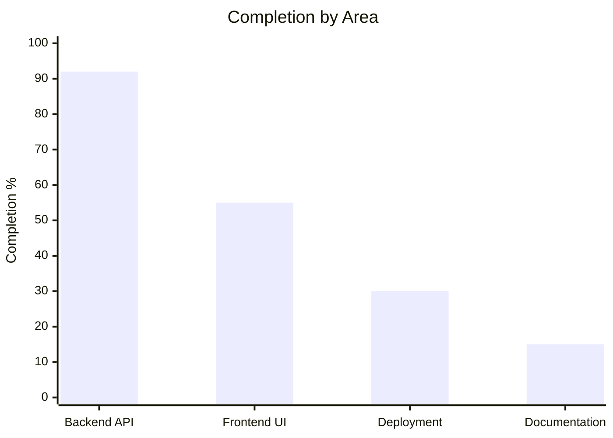

# 🩸 Project Completion Audit — Cloud-Based Blood Bank Management System

## Overall Completion: ~60%

> [!CAUTION]
> **Critical Blocker:** The app will **NOT compile or run** right now. `App.jsx` imports 8 page components that don't exist on disk — this causes a build failure.

---

## Module-by-Module Status

| Module | Backend | Frontend | Overall |
|--------|:-------:|:--------:|:-------:|
| 1. Donor Registration & Profile | ✅ 100% | ✅ 100% | **✅ 100%** |
| 2. Blood Inventory Management | ✅ 100% | ⚠️ 65% | **⚠️ 80%** |
| 3. Blood Request Management | ✅ 100% | ❌ 0% | **❌ 50%** |
| 4. Blood Donation Camp Management | ✅ 100% | ❌ 0% | **❌ 45%** |
| 5. Donor Search & Matching | ✅ 90% | ✅ 100% | **✅ 90%** |
| 6. Expiry Alerts & Notifications | ⚠️ 60% | ❌ 0% | **❌ 35%** |

---

## Phase-by-Phase Status

| Phase | Status | Completion |
|-------|--------|:----------:|
| Phase 1: Setup & Auth | Login, Register, Auth middleware, role-based access — all working | **95%** |
| Phase 2: Donor & Inventory | Backend complete, most frontend pages done, 2 pages missing | **85%** |
| Phase 3: Requests & Camps | Backend complete, **all 5 frontend pages missing** | **50%** |
| Phase 4: Notifications & Search | Backend services exist, **no auto-triggers wired**, page missing | **55%** |
| Phase 5: Deployment | Dockerfile exists, no Firebase/Cloud Run configs | **30%** |
| Phase 6: Documentation | README exists, **docs folder is empty** | **15%** |

---

## ✅ What IS Implemented

### Backend — Excellent (92%)
- **7 route files** — auth, users, donors, inventory, requests, camps, notifications
- **6 service files** — full business logic for all modules
- **6 Marshmallow model schemas** — with validation
- **Auth middleware** — Firebase token verification + role-based access (`@require_auth`, `@require_role`)
- **Utilities** — blood compatibility chart, input validators
- **Email service** — Flask-Mail with Gmail SMTP (functions defined)
- **Dockerfile** — production-ready with gunicorn

### Frontend — Partial (55%)
- **Core infrastructure** — routing, auth context, API client, all 5 service files
- **Layout** — Navbar, Sidebar (role-based menus), Footer
- **12 shadcn/ui components** — badge, button, card, dialog, etc.
- **9 pages implemented:**
  - `LoginPage.jsx`, `RegisterPage.jsx`
  - `DashboardPage.jsx` (3 role-based dashboards: Admin, Hospital, Donor)
  - `DonorListPage.jsx`, `DonorSearchPage.jsx`, `DonorRegisterPage.jsx`, `DonorProfilePage.jsx`
  - `InventoryListPage.jsx`, `AddBloodUnitPage.jsx`

---

## ❌ What is MISSING

### 🔴 8 Missing Frontend Pages (imported in App.jsx but files don't exist)

| # | Missing Page | Route | Purpose |
|---|-------------|-------|---------|
| 1 | `BloodStockPage.jsx` | `/inventory/stock` | Visual blood stock summary |
| 2 | `ExpiringUnitsPage.jsx` | `/inventory/expiring` | Expiring units list |
| 3 | `RequestListPage.jsx` | `/requests` | Blood request management |
| 4 | `NewRequestPage.jsx` | `/requests/new` | Submit new blood request |
| 5 | `CampListPage.jsx` | `/camps` | View all donation camps |
| 6 | `CreateCampPage.jsx` | `/camps/create` | Create new camp |
| 7 | `MyCampsPage.jsx` | `/camps/my` | Donor's registered camps |
| 8 | `NotificationsPage.jsx` | `/notifications` | View notifications |

### 🟡 Backend–Frontend Endpoint Mismatches
- Frontend calls `/api/users/register` → backend has `/api/auth/register`
- Frontend calls `/api/donors/profile` → backend has `/api/donors/me`
- Frontend calls `/api/donors/history`, `/api/donors/stats` → no backend routes
- Frontend calls `/api/inventory/stock` → backend has `/api/inventory/summary`
- Frontend calls `/api/requests/my`, `/api/requests/stats` → no backend routes
- Frontend calls `/api/camps/my`, `/api/camps/<id>/registrations` → no backend routes
- Frontend calls `/api/notifications/read-all` → no backend route

### 🟡 Backend Auto-Triggers Not Wired
- No Cloud Scheduler cron for automatic expiry checking
- Low-stock alert generation logic never called
- Camp reminder emails never triggered
- Blood compatibility not used in request approval flow

### 🟢 Documentation & Deployment
- `docs/project-report.md` — empty/missing
- `docs/architecture-diagram.png` — missing
- `firebase.json` — missing (Firebase Hosting not configured)
- `cloudbuild.yaml` — missing (no CI/CD)

---

## Priority Fix Order

| Priority | Task | Impact |
|:--------:|------|--------|
| 🔴 1 | Create 8 missing frontend pages | **App won't run without these** |
| 🟡 2 | Fix frontend↔backend endpoint mismatches | API calls will 404 |
| 🟡 3 | Wire auto-triggers (expiry cron, low-stock, camp reminders) | Module 6 incomplete |
| 🟡 4 | Wire blood compatibility into request processing | Module 5 incomplete |
| 🟢 5 | Create project report & architecture diagram | Phase 6 incomplete |
| 🟢 6 | Add `firebase.json` for hosting deployment | Phase 5 incomplete |

